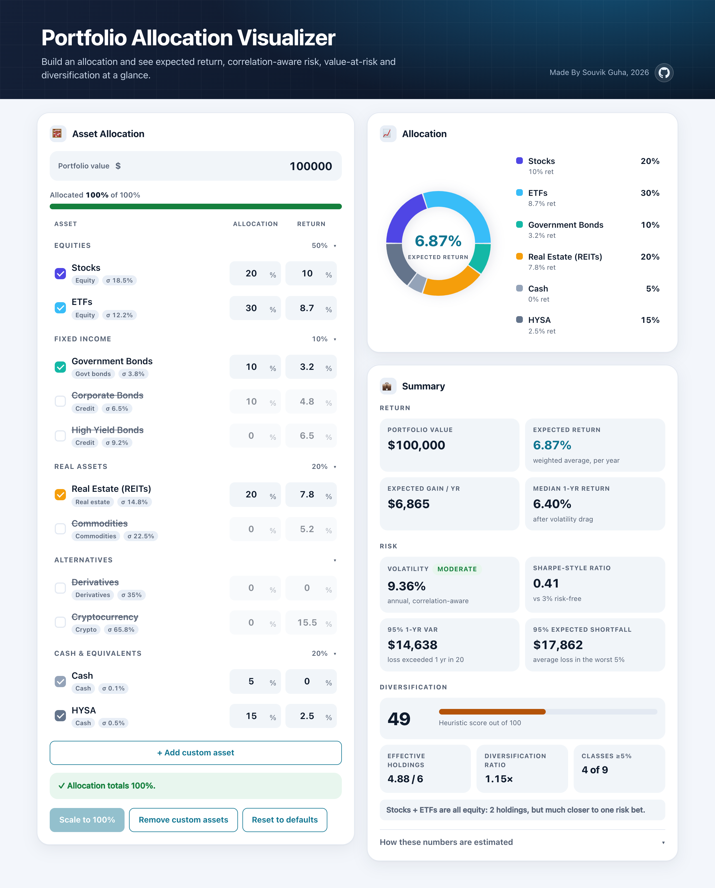
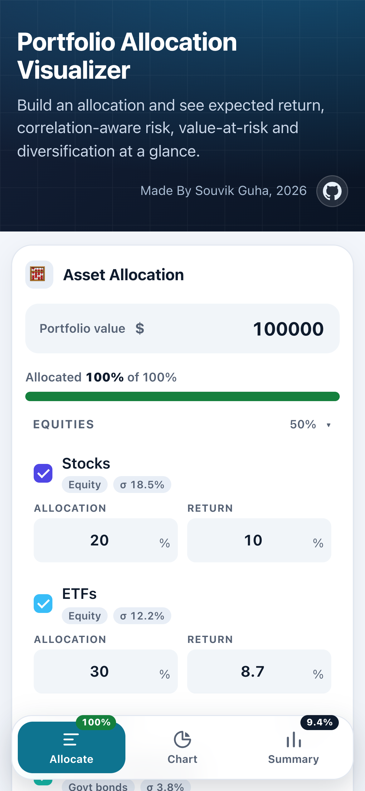
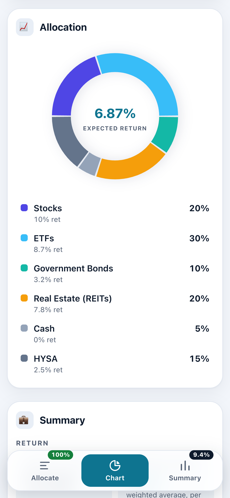
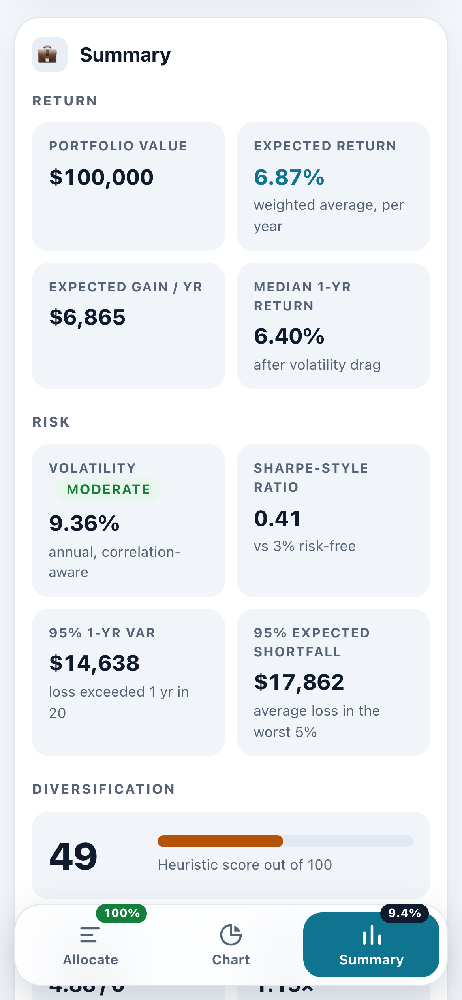
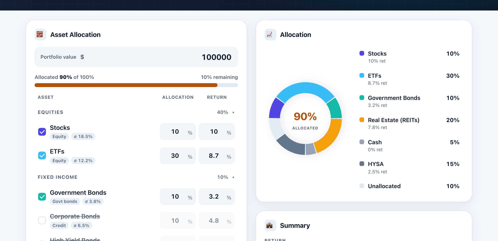

# Portfolio Allocation Visualizer

A single-file, zero-dependency page that turns an asset allocation into a chart plus correlation-aware risk numbers: expected return, volatility, value-at-risk, expected shortfall and diversification.

**Live:** https://souvik-guha.github.io/portfolio-allocation-visualizer/  
Open `index.html` locally and it works offline. There are no network requests, CDNs or web fonts.

<p align="center"></p>

| Allocate | Chart | Summary |
|---|---|---|
|  |  |  |

## What it does
- Enter an allocation and an expected annual return for each asset (stocks, ETFs, bonds, REITs, commodities, derivatives, crypto, cash) and add your own custom assets, including private ventures.
- The allocation must total **100%**. Under- or over-allocation is shown as an error with a live meter and the risk figures are withheld rather than silently rescaled. *Scale to 100%* is an explicit button.
- Live doughnut chart (inline SVG), legend, and a summary of return, risk and diversification.
- Responsive, with a bottom tab bar on phones.

<p align="center"></p>

## How the numbers are computed
| Metric | Definition |
|---|---|
| Expected return | Σ wᵢ·rᵢ (exact decimal arithmetic via decimal.js) |
| Volatility σ | √(w′Σw), using each asset's volatility and correlations. It is not a weighted average of volatilities. |
| Correlation | Each asset = √λ·(class factor) + idiosyncratic part. Same-class pairs have correlation λ; different classes use √(λₐλ_b)·(factor correlation). This construction is always positive semi-definite. |
| Median 1-yr return | (1 + μ)·e^(−σ²/2) − 1, the volatility drag |
| VaR / ES (95%, 1 yr) | Lognormal, zero drift: loss = 1 − exp(−σ²/2 − zσ). ES = 1 − Φ(−z−σ)/0.05. Always within [0, 100%] of the portfolio. |
| Sharpe-style ratio | (μ − 3%) / σ |
| Effective holdings | 1 / Σw² |
| Diversification ratio | Σwᵢσᵢ / σ |
| Diversification score | Heuristic: 50% diversification benefit (1 − 1/ratio, full at 40%) + 50% risk spread (effective risk bets − 1, full at 3 more) |

### Placeholder assumptions to review
All volatilities, the class factor correlations, the same-class λ values, the 3% risk-free rate and the score/profile thresholds are **illustrative placeholders, not market estimates**. Change them in the `DEFAULTS`, `CLASSES`, `PAIRS` and `RF` constants at the top of the script. The model is long-only with no leverage, and the lognormal VaR still understates fat-tailed crashes.

## Testing
```bash
npm install
CHROME_PATH="/path/to/chrome" npm test
```
- `tests/model.test.js` drives the real page in headless Chrome, reads the inputs from the DOM and recomputes every figure with an independent implementation. Expected shortfall is checked by numerical integration rather than the page's closed form. It covers a hand-checked reference portfolio, closed-form cases, every asset and class alone, thousands of seeded random portfolios (including custom assets, extreme returns and volatilities), non-100% totals, invalid and blank inputs, and XSS-style names. The latest run was 188,007 assertions across 8,466 scenarios with 0 failures.
- `tests/layout.test.js` checks at 10 viewport widths (1440 down to 320 px) that no element escapes its card and nothing scrolls sideways, including with extreme values and very long names. It also checks the mobile tab navigation.
- The page also passes ESLint (recommended-style rules), html-validate and axe-core with no violations.

## Files
- `index.html` is the whole app (CSS, JS and an inlined, minified copy of [decimal.js](https://github.com/MikeMcl/decimal.js) 10.4.3, MIT).
- `tests/` holds the verification scripts; `docs/` holds screenshots.

## Notes
This is a visualiser. It models the numbers you enter and recommends nothing.

Made by [Souvik Guha](https://github.com/souvik-guha), 2026. MIT licensed.
